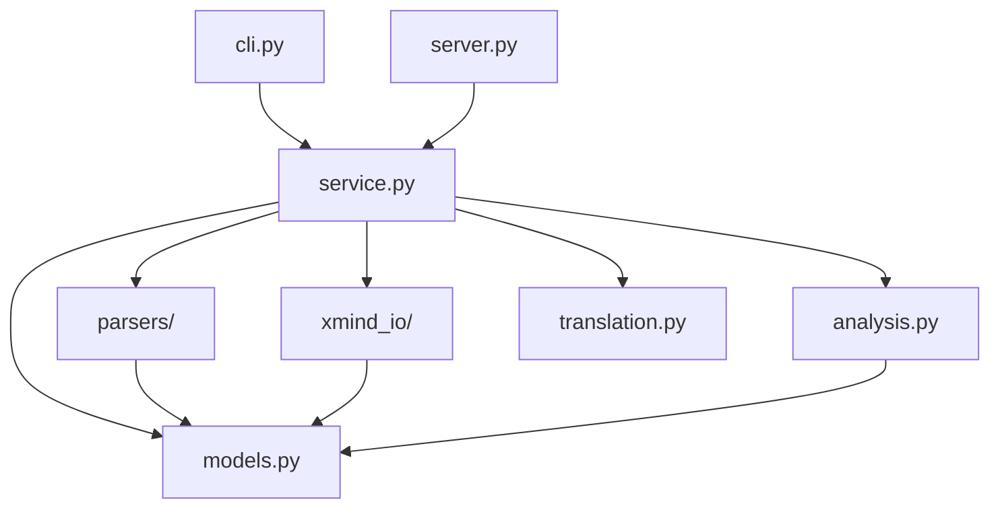

# 架构说明

[返回文档导航](README.md)

实现集中在 `xmind_mcp/` 包内，根目录旧脚本和导入 API 已移除。六个 MCP 工具的名称、参数别名、JSON 文本结果及新旧协议支持保持可用。

## 依赖方向



包内模块直接引用包内实现。导入 `xmind_mcp`、应用服务或 MCP 适配模块，不会切换工作目录、修改 `sys.path`、配置根日志或创建全局服务器。日志配置只发生在 CLI 主函数中。

## 模型与格式边界

- `Topic` 统一使用 `list[Topic]` 表达子主题；`extra` 保留未知节点属性，`group` 保留 attached/detached 等子主题分组。
- `Document` 表示当前使用的画布及其主题树，保留画布级未知字段和样式。
- `ReadLimits` 表达读取预算；`Stats` 表达结构统计。树遍历、标题层级连接及输入别名归一化共用模型层函数。
- 格式解析器返回 `Document`。XMind 的 `rootTopic`、分组式 `children` 和默认主题样式只在读写适配层转换。
- 当前读取与分析仍按原有行为处理首个画布。模型重写不是任意 XMind 文件的无损编辑接口；翻译使用原始压缩包，只替换标题内容成员，保留其他画布、附件及未知压缩包成员。

## 应用服务与错误

`XMindService` 负责创建、读取、转换、分析、列举及翻译用例。输入/输出路径规则在 `Settings` 中统一；CLI 先将用户输入的相对文件路径转换为绝对路径，MCP 转换工具继续要求绝对源路径。

内部适配器可抛出带稳定 `code` 的 `XMindError`。公开服务方法在统一边界返回原有 `status/message/data/stats` 格式，失败附加 `error_code`。MCP 适配器只做工具注册、JSON 序列化和输出路径展示过滤，不自行重写业务规则。

工具定义只在 `server.tool_handlers` 中声明一次，由 SDK 注册并生成 schema。应用显式创建服务实例，没有旧引擎的惰性单例或限额属性适配层。

## 显式配置与实例隔离

```python
from pathlib import Path
from xmind_mcp.models import ReadLimits
from xmind_mcp.settings import Settings
from xmind_mcp.service import XMindService
from xmind_mcp.server import create_server

settings = Settings(
    base_dir=Path('/absolute/workspace'),
    default_output_dir=Path('/absolute/output'),
    read_limits=ReadLimits(max_content_bytes=50 * 1024 * 1024, max_nodes=10000, max_depth=20),
)
service = XMindService(settings)
server = create_server(service=service)
# 明确需要运行时再调用 server.run(transport='stdio')
```

`Settings.from_env()` 在调用时读取环境变量；配置创建后不随环境变量变化。`base_dir` 默认取创建配置时的工作目录，后续进程工作目录变化不影响相对读取路径。默认输出目录优先级继续为 CLI 参数、环境变量；相对默认目录需要显式配置绝对 `XMIND_MCP_BASE_DIR`。

同一进程可创建多个服务和服务器，每个服务拥有自己的配置和解析器注册表。

## 增加格式或替换翻译器

```python
from xmind_mcp.models import Document, Topic
from xmind_mcp.parsers import BaseParser

class CustomParser(BaseParser):
    def parse(self) -> Document:
        return Document(Topic(self.file_path.read_text(encoding='utf-8')))

service.parser_factory.register('.custom', CustomParser)
```

注册只影响当前服务。解析器处理输入格式，不负责输出文件、MCP 协议或命令行参数。

翻译器通过 `XMindService(settings, translator_factory=factory)` 注入。工厂接收目标语言，返回具有 `translate(text) -> str` 方法的对象。默认实现惰性加载 deep-translator；测试使用本地假实现，不发送网络请求。可选 AI 扩展独立于六个核心工具。

## 入口与验证

- MCP：`python -m xmind_mcp`、`xmind-mcp`、`xmind-mcp-server` 均进入 `xmind_mcp.cli.main`。
- 文件转换：`xmind-convert input.md output.xmind` 进入 `xmind_mcp.cli.convert_main`，复用同一个应用服务。
- Python 库调用：直接使用 `XMindService`、`Settings` 和包内模型；解析器统一返回 `Document`。
- 分发 wheel 仅包含 `xmind_mcp` 包，不再安装根目录模块或旧 JSON 字典解析器 API。

测试、构建、wheel 验证及发布流程见 [开发与发布](DEVELOPMENT.md)；工具参数和路径规则见 [使用指南](USAGE_GUIDE.md)。

## 包结构与模块边界

```text
xmind_mcp/
├── cli.py              # 参数解析、日志配置及应用组装
├── server.py           # 服务器工厂及唯一工具声明
├── settings.py         # 配置快照与路径策略
├── models.py           # 统一文档、主题、预算及统计模型
├── service.py          # 应用用例编排
├── errors.py           # 错误类型与统一返回边界
├── presentation.py     # MCP 输出展示
├── analysis.py         # 纯结构分析
├── translation.py      # 可注入翻译器与原压缩包保留
├── parsers/            # 五类格式解析器及实例级注册表
└── xmind_io/           # XMind ZIP、JSON、XML、样式与原子写入
```

所有实现均由包内入口访问。`ai_extensions.py` 是独立可选能力，不等同于已注册的 MCP 工具。

当前架构已落实旧优化报告中的模型统一、职责拆分、配置隔离、导入副作用清理与格式扩展接口。后续新增功能沿现有边界扩展，不再维护与实现分离的假想接口、重复工具 schema 或未验证性能承诺。
